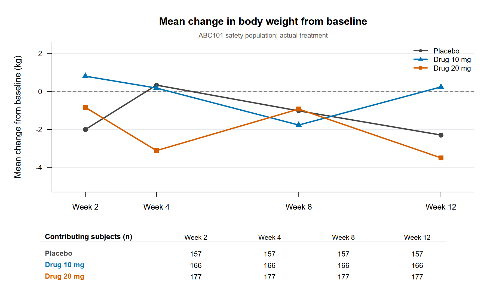

> **SYNTHETIC DATA — EDUCATIONAL REVIEW DEMONSTRATION.** ABC101 has no real participants, protocol, SAP, source CRFs, or clinical conclusions. The CSVs, Define-XML, displays, and checks below are not an FDA submission or a claim of CDISC conformance.

**Report version:** 1.0  
**Source snapshot:** current project outputs and documents, reviewed 2026-10-13  
**Purpose:** navigate the generated data and its descriptive safety displays, with their documented limitations.

## Study assumptions and scope

The [versioned study-design assumptions](../docs/ABC101_synthetic_study_design_and_standards_v1.0.md) define an illustrative type 2 diabetes study with **500 generated subjects** in three arms: Placebo, Drug 10 mg, and Drug 20 mg. The assumed study start of **2025-01-01** was selected for a retrospective standards-version exercise; it is not an actual protocol or consent date. Planned and actual arms match in this generated dataset. Each subject has one exposure interval from 2025-01-01 to 2025-03-26 inclusive, represented as one tablet once daily; the interval does not document dose-by-dose adherence or mg actually taken.

LB and VS have Baseline and Weeks 2, 4, 8, and 12. Baseline is selected by visit label. Baseline collection and first exposure share a date, but no times establish a predose measurement. All 500 generated subjects have `ITTFL=Y` and `SAFFL=Y` by project convention. Table 1 uses the planned arm; the safety displays use the actual arm. The [cSDRG](../docs/ABC101_synthetic_cSDRG_v1.0.md) and [ADRG](../docs/ABC101_synthetic_ADRG_v1.0.md) give dataset-level navigation and traceability.

## Data flow and traceability

```{mermaid}
flowchart LR
  A[Generated raw CSVs] --> B[SDTM-like CSVs<br/>DM AE LB VS EX]
  B --> C[ADaM-like CSVs<br/>ADSL ADAE ADLB ADVS]
  C --> D[Tables 1–4<br/>Listing 1<br/>Figure 1]
  B --> E[SDTM QC]
  C --> F[ADaM QC]
  D --> G[Independent TLF QC]
  B --> H[CSV-linked Define-XML]
  C --> H
  H --> I[Limited conformance screening]
```

The five [SDTM CSVs](../data/sdtm/dm.csv) derive from generated raw demographics, adverse events, labs, vital signs, and exposure. The four [ADaM CSVs](../data/adam/adsl.csv) use SDTM DM/EX for ADSL and SDTM AE/LB/VS plus ADSL for the record-level datasets. `USUBJID` links subjects. ADAE, ADLB, and ADVS retain source sequence values in `SRCSEQ`; ADLB/ADVS also identify their selected baseline row with `BLSEQ`. The [SDTM specifications](../docs/ABC101_synthetic_SDTM_dataset_specifications_v1.0.md), [ADaM specifications](../docs/ABC101_synthetic_ADaM_dataset_specifications_v1.0.md), and CSV-linked [Define-XML metadata](../docs/ABC101_synthetic_define_xml_preparation_v1.0.md) describe the mappings.

The analysis TEAE flag is `Y` when AE onset is from `TRTSDT` through 30 days after `TRTEDT`, inclusive; with current fixed dates, the window ends 2025-04-25. ADAE retains events outside the window. ADLB/ADVS use a single visit-based baseline per subject/test, then calculate postbaseline change and percent change. These rules are programming conventions for this synthetic example, not SAP decisions.

## Descriptive tables

The tables below are included directly from the corresponding generated Markdown displays. Their source CSVs and R programs are linked in the [ADRG](../docs/ABC101_synthetic_ADRG_v1.0.md). Values are descriptive and have no clinical interpretation.









## Listing 1 — subject-level adverse events

[Listing 1 Markdown](../output/listings/listing_01_subject_ae.md) and [CSV](../output/listings/listing_01_subject_ae.csv) contain **all 750 ADAE records**, including events without `TRTEMFL=Y`. It displays subject ID, actual treatment, event term, start and end dates, severity, seriousness, outcome, and treatment-emergent status. Rows are sorted by actual treatment, subject, start date, and `ASEQ`. The full listing is linked rather than repeated here to keep this report navigable.

## Figure 1 — mean weight change

Figure 1 uses safety-population ADVS `PARAMCD=WEIGHT` postbaseline records. It plots mean `CHG` in kg at Weeks 2, 4, 8, and 12 for each actual treatment arm, with contributing subject counts under the plot. The [plotted summary CSV](../output/figures/figure_01_weight_change.csv) contains **12 arm-by-visit rows**. The figure is a descriptive programming output, not evidence of treatment effect.

{fig-alt="Line chart of mean body weight change for three synthetic treatment groups at Weeks 2, 4, 8, and 12, with subject counts shown below the plot." width=100%}

## QC and standards screening

| Evidence | Current result | Interpretation |
| --- | --- | --- |
| [SDTM cross-domain QC](../output/qc/sdtm_validation_report.md) | PASS, **45/45** checks | Internal keys, links, dates, visits, and exposure consistency |
| [ADaM QC](../output/qc/adam_validation_report.md) | PASS, **52/52** checks | Internal source coverage, treatment, baseline, change, and TEAE derivations |
| [Final TLF QC](../output/qc/tlf_validation_report.md) | PASS, **36/36** checks in the current report | Independent ADaM-based recalculation and output checks; includes optional visual attestation tied to the exact Figure 1 PNG hash |
| [Dataset-specification validation](../docs/ABC101_dataset_spec_validation_v1.0.md) | PASS, **182/182** variables over **48,000** rows | Project mapping and column-order agreement |
| [Limited conformance screening](../output/qc/ABC101_synthetic_conformance_findings_v1.0.md) | **8/8** local checks pass; **9** open or untested areas | Selected CSV/XML properties only; no published CDISC/FDA rule-workbook pass rate |

These project checks establish reproducibility and internal agreement for the current synthetic outputs. They do not certify standards conformance, medical coding, or submission readiness. The [SDTM](../metadata/v1.0/sdtm/define.xml) and [ADaM](../metadata/v1.0/adam/define.xml) XML files describe CSVs with `def:Context=Other`; a prior structural XSD check did not verify the selected controlled-terminology package.

## Open conformance gaps and review limits

The [versioned screening findings](../output/qc/ABC101_synthetic_conformance_findings_v1.0.md) distinguish observed gaps from untested areas. For this demonstration, the key unresolved items are:

1. **Submission transport and context:** data are CSVs, not XPT. There is no TS dataset, study tagging file, or eCTD package for FDA receipt-level checks. The assumed start date is not substantiated by an actual protocol.
2. **Terminology and coding:** the selected package-58 codelists have not been mapped or validated. `AEDECOD` is an uppercase source term, not a MedDRA-coded preferred term.
3. **Metadata and origins:** Define-XML references CSVs and lacks package-58 codelists and ADaM analysis-results metadata. No real aCRF or source system can support collection-origin claims.
4. **Formal rule execution:** the CDISC SDTM, ADaM, and Define-XML conformance-rule workbooks and FDA Business/Validator rules were not run. The eight local screening checks do not substitute for them.
5. **Clinical interpretation:** there is no SAP, endpoint rationale, predose timing evidence, adherence history, or clinical source record. The displayed differences cannot support efficacy or safety conclusions.

## Reproduce this report

From the project root, first generate and QC outputs with `Rscript run_all.R` if working from a fresh checkout. To reproduce the **current visually attested** TLF QC report, inspect the rendered Figure 1 PNG and follow the optional SHA-256 review command in the [README](../README.md); a normal runner execution records 35 automated TLF checks. Run `python qc/validate_conformance_v1_0.py` for the limited screening. Then render this file with `quarto render reports/ABC101_synthetic_review_v1.0.qmd --to html`. That writes `reports/ABC101_synthetic_review_v1.0.html`; the report links to files in this checkout. Regeneration may change the exact Figure 1 PNG bytes across R versions or graphics devices.
